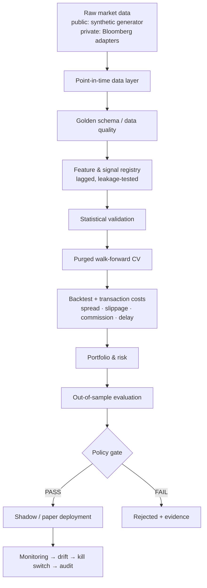
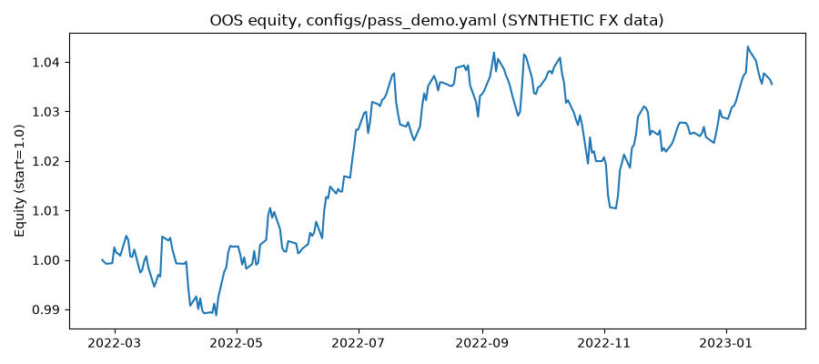

<!-- PUBLIC MIRROR -->
> **Public OSS mirror** of the FX quantitative research framework.
> Bloomberg/enterprise adapters and secrets live only in the private repository
> [`Kozphy/ForexTraderWithBloombergAccess`](https://github.com/Kozphy/ForexTraderWithBloombergAccess).

# ForexTraderWithBloombergAccess

Reproducible quantitative research from raw market data to statistically validated, policy-controlled deployment.

This repository is a **research and simulation framework** with automated integrity tests. It does not claim live profitability, and CI runs on synthetic FX-like data so the pipeline is executable without proprietary Bloomberg credentials.

> **Data note:** this public version runs **only on synthetic FX-like data** generated by the configs. The Bloomberg and enterprise data adapters (`src/internal/`) are **private** and are not in this repo. Nothing here uses or redistributes Bloomberg data.



## Sample run (real output, synthetic data)

This output came from `python -m forex_quant.pipeline --config configs/pass_demo.yaml --artifacts artifacts`, run on 2026-10-30. `pass_demo.yaml` has deliberately **relaxed gates** to exercise the PASS path, so the numbers below show how the pipeline works and are **not** evidence of a trading edge. Running `configs/fail_demo.yaml` on the same day returned `FAIL`, as designed.



Excerpt from the generated `report.md` (full file: [docs/sample-run/pass_demo_report.md](docs/sample-run/pass_demo_report.md)):

| Item | Value |
|---|---|
| Policy verdict | PASS (research → candidate) |
| Dataset | `synthetic_fx_v1`, 800 periods |
| Leakage tests | pass (purge 5 / embargo 3) |
| OOS Sharpe | 1.00 (buy-and-hold: −0.26) |
| OOS CAGR | 3.73% |
| OOS max drawdown | −3.02% |
| Walk-forward mean Sharpe | 0.31 |
| Bootstrap mean-return CI | [−0.00018, 0.00042] (includes zero) |
| Transaction cost drag | 0.00118 |

## Work with me

I build and validate trading research pipelines, backtests and automation. **Upwork:** https://www.upwork.com/freelancers/~01f2d28a00fa4262d3

## What is demonstrated by tests and artifacts

- Point-in-time dataset construction, schema validation, lineage and fingerprinting
- Causal (lagged) features and leakage rejection tests
- Cost-aware backtests with spread, slippage, commission, execution delay and liquidity caps
- Train / validation / OOS separation with purged walk-forward folds
- Configurable promotion policy that never silently promotes failures
- Control-plane primitives: human approval, retry budget, kill switch, JSONL audit
- Evidence bundles under `artifacts/<experiment_id>/` with reviewer reports

## Quick start

```bash
python -m pip install -e ".[dev]"
pytest -q
python -m forex_quant.pipeline --config configs/baseline.yaml --artifacts artifacts
```

## Sample experiments

| Config | Intent | Typical policy verdict on synthetic data |
|--------|--------|------------------------------------------|
| `configs/baseline.yaml` | Default research gates | Depends on draw; inspect artifacts |
| `configs/pass_demo.yaml` | Relaxed gates to exercise PASS path | **PASS** → `candidate` |
| `configs/fail_demo.yaml` | Unreachable thresholds to exercise FAIL path | **FAIL** → `rejected` |

```bash
python -m forex_quant.pipeline --config configs/pass_demo.yaml --artifacts artifacts
python -m forex_quant.pipeline --config configs/fail_demo.yaml --artifacts artifacts
```

Inspect `artifacts/exp_*/report.md` and `policy_decision.json`.

## Dual-repo workflow

| Repository | Visibility | Contents |
|------------|------------|----------|
| [`Kozphy/ForexTraderWithBloombergAccess`](https://github.com/Kozphy/ForexTraderWithBloombergAccess) | Private | Full tree, including `src/internal/` (Bloomberg/enterprise adapters), sync workflow, local artifacts |
| [`Kozphy/ForexTraderWithBloombergAccess-public`](https://github.com/Kozphy/ForexTraderWithBloombergAccess-public) | Public | Allowlisted OSS surface only (`src/forex_quant/`, docs, tests, synthetic configs) |

On every push to private `main`, `.github/workflows/sync-public-mirror.yml` runs `scripts/sync_public_mirror.sh` and force-pushes a clean allowlisted tree to the public mirror. Secrets (`.env`, `.secrets`, tokens) and `src/internal/` never leave the private repo.

Manual dry-run:

```bash
DRY_RUN=1 ./scripts/sync_public_mirror.sh
```

## Architecture

See [architecture.md](architecture.md) for the module map and control-plane lifecycle.

Supporting docs:

- [research_methodology.md](research_methodology.md)
- [reproducibility.md](reproducibility.md)
- [benchmark.md](benchmark.md) — benchmark and failure-mode tables
- [threat_model.md](threat_model.md) — threats to validity
- [reports/RESEARCH_TEMPLATE.md](reports/RESEARCH_TEMPLATE.md)

## Repository layout

```text
src/forex_quant/      # public research framework (mirrored)
src/internal/         # private-only Bloomberg/enterprise adapters (never mirrored)
configs/
  baseline.yaml
  pass_demo.yaml
tests/                # unit, data-contract, leakage, policy, audit
artifacts/            # generated evidence (local / CI; not mirrored)
evidence/             # curated pointers / gap analysis
scripts/
  sync_public_mirror.sh
```

## CI research-integrity gate

GitHub Actions runs:

1. Unit tests  
2. Data-contract tests  
3. Leakage tests  
4. Research harness / policy / audit tests  
5. Smoke pipeline + artifact schema checks  

A PR fails when research integrity requirements fail.

## Limitations

- Demo market data is synthetic; Bloomberg adapters are out of band.
- Statistical utilities are research building blocks, not independent model validation.
- Market-impact and capacity models are approximations.
- No unattended live execution path is provided.

## Threats to validity

Summarized in [threat_model.md](threat_model.md): leakage, survivorship, multiple testing, cost understatement, non-stationarity and irreproducibility.
